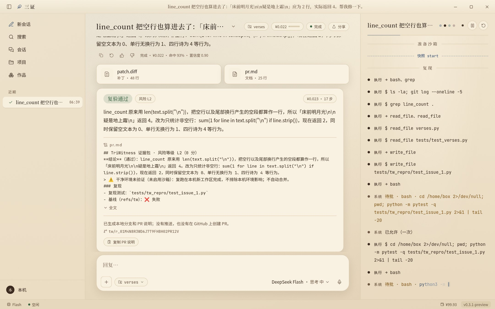
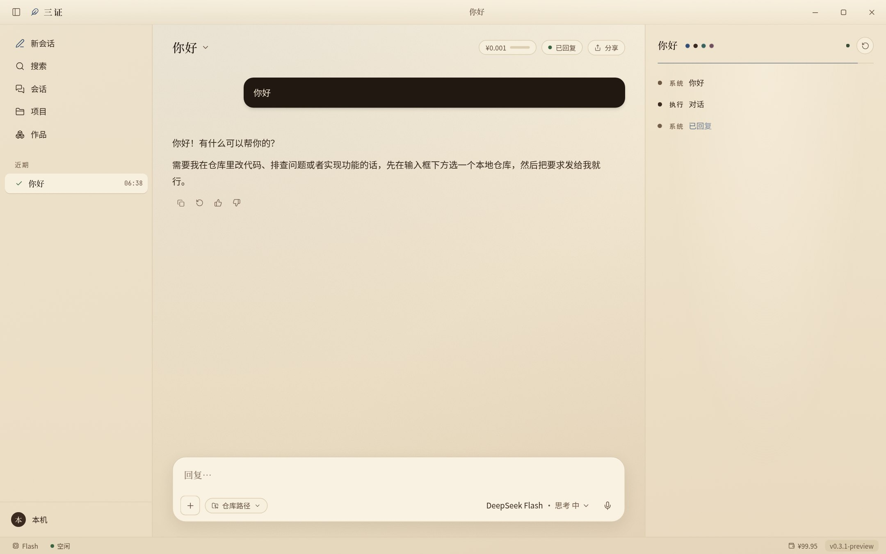
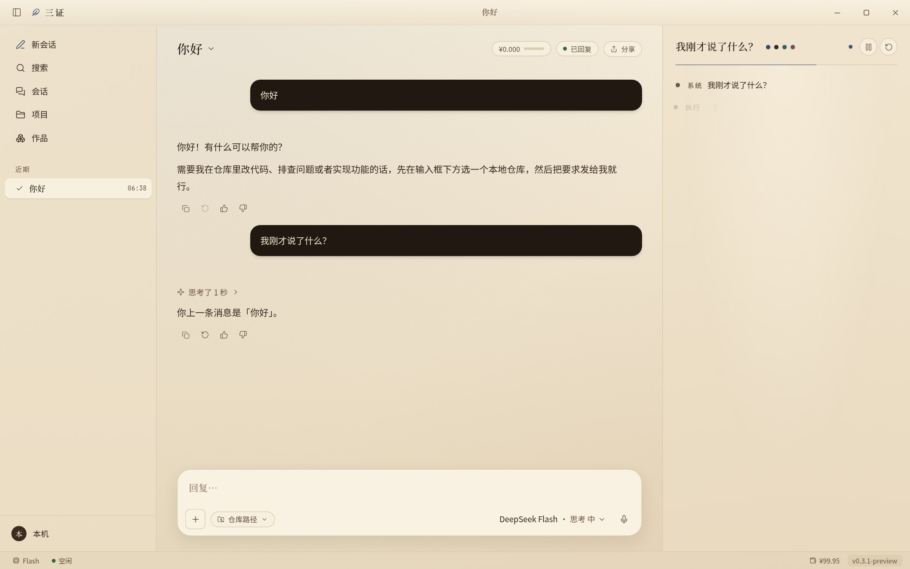

# TriWitness（三证）· v0.3.1 公开预览

**先验证、再交付的本地 Coding Agent（Windows 桌面端）。** 你给它一个仓库和一段问题描述，它会：先写一个能复现问题的测试 → 修代码 → 在独立工作区里重新跑复现测试和原有测试 → 做防作弊检查、给风险等级 → 生成一个**本地分支**和一份带**证据包的 PR 说明**（pr.md）。

> v0.3.1 是**预览版**：需要你自己的 DeepSeek API 密钥（从 0.3.1 起没有演示模式，一律用真实模型）。可以像聊天一样问它问题，要它修仓库里的问题时它才动手。它**不会推送代码，也不会在 GitHub 上创建 PR**，只在本地生成分支和 PR 说明，要不要推送、开 PR 由你决定。完整限制见 [已知限制](docs/release/known-limitations.md)。

<p align="center">
  <br>
  <sub>结论卡：复验结论 · 风险等级 · PR 说明 · 本地分支</sub>
</p>

| 打招呼：直接回复，不开工 | 多轮：同一会话里跟进 |
|---|---|
|  |  |

## 安装（Windows 10 / 11，x64）

1. 到 [Releases](https://github.com/Akarin7784/triwitness/releases) 下载 `TriWitness_0.3.1-preview_x64-setup.exe`，以及同名的 `.sha256` 文件（可选，用来核对文件没被改过：PowerShell 里 `Get-FileHash .\TriWitness_0.3.1-preview_x64-setup.exe`）。
2. 双击安装。安装包**没有代码签名**，Windows SmartScreen 会提示“Windows 已保护你的电脑”：点 **更多信息 → 仍要运行**。按当前用户安装，不需要管理员权限。
3. 需要 [Git for Windows](https://git-scm.com/download/win)（建工作区、跑命令都靠它；装的时候保持默认选项即可）。缺 WebView2 时安装程序会自动下载。

安装包里已经带了打包好的核心（`tw.exe`，PyInstaller），**不需要另装 Python 才能运行 TriWitness 本身**。但修你自己的 Python 项目时，跑测试用的是你项目自己的 Python 环境。

## 快速开始

**需要一个 DeepSeek API 密钥**（到 [DeepSeek 开放平台](https://platform.deepseek.com/api_keys) 创建）。

1. 第一次打开应用会弹出“连接 DeepSeek”：粘贴密钥 → 保存并继续。密钥存进 Windows 凭据管理器，不写进任何文件或日志（之后可在 设置 → 模型 → DeepSeek API 密钥 更换 / 清除）。没填密钥就发送也会弹出这个对话框。
2. 新会话里随便说句话（比如“你好”）：它会直接回答，不会动任何代码。
3. 要它修问题：在输入框下方选你的本地 git 仓库，写清楚问题，发送。它会先复现 → 修复 → 复验 → 给出结论卡。同一会话里可以继续追问。默认单任务上限 ¥1.00，可以在设置 → 预算里调低。

只用 `deepseek-flash`。每条消息（包括打招呼）都是一次真实调用，记入本机账本；打招呼这类直接回复通常不到 ¥0.001。

建议在 DeepSeek 空闲时段运行（北京时间工作日 9:00–12:00、14:00–18:00 以外）；高峰时段价格翻倍，默认直接拦下。

命令行（开发者）：

```bash
uv sync
uv run tw run --repo <仓库> --issue "<问题>" --live  # 真实调用，计费
uv run tw run --jsonl --live --issue "你好"         # 桌面端同款对话轮（可不带仓库）
uv run tw budget                                    # 账本
```

## 权限模式

| 模式 | 行为 |
|---|---|
| 只读 | 只看不改，先出方案 |
| 询问 | 改文件、跑命令前都弹审批卡：允许一次 / 本次任务 / 总是 / 拒绝 |
| 模型自动审批（默认） | 有风险的操作交给审核模型（DeepSeek Flash，不思考，每次约 ¥0.0003）按策略批准或拒绝，没把握再问你 |
| 完全访问 | 两步确认、红色横幅、任务结束自动退回；CI / 非交互环境下拒绝 |

规则（`Tool(specifier)`，deny → ask → allow）在 设置 → 权限 里可以直接编辑；默认 54 条拒绝、38 条询问。沙箱后端（无 / Docker）是单独的设置，和权限模式互不影响。

## 成本说明

- 只用 DeepSeek `deepseek-flash`，按 token 计费；真实调用记在本机账本 `~/.triwitness/ledger.sqlite`，设置 → 预算 里能看到每次调用的花费和缓存命中率。
- 参考数据（项目自己的评测，空闲价）：一次修复任务通常 **¥0.05–0.30**；前缀缓存命中率 95% 以上。
- 单任务上限默认 ¥1.00（只能调低），超了就停；总预算 ¥100 的熔断开关也在核心里。
- 开发 / 测试用的回放和本机模拟服务（`packaging/mock_llm.py`）¥0，只在源码里，不在安装包里。

## 已知限制（摘要）

- 不推送、不在 GitHub 上开 PR、不回帖 Issue：只生成本地分支 `tw/<run_id>` 和 PR 说明（结论卡上可以“复制 PR 说明”“打开运行目录”）。
- 只有 Executor 单角色 + 确定性复验；Planner / Reviewer 角色、断点续跑还没做。
- 未签名、没有自动更新（“检查更新”打开 Releases 页面）。
- 真实模式的流式输出和审核模型在 App 里还没有经过真机长时间验证；Windows 真机上的一键安装 Docker 没走通过。
- 界面上标“即将推出”的入口（语音、连接器、更多模型等）点了只会提示。

完整列表：[docs/release/known-limitations.md](docs/release/known-limitations.md)。更新记录：[CHANGELOG.md](CHANGELOG.md)。

## 路线图

- **v0.3.x**：根据预览反馈修 bug；Windows 真机清单逐项过完；真实模式长任务验证。
- **v1.0**：代码签名、自动更新、审批后推送分支并开 PR（最小权限令牌）、断点续跑、本地诊断导出。
- **之后**：Planner / Reviewer 编排、消融评测、WSL2 后端、Qwen / GLM 跨厂商互审（等资金）。

## 开发

```bash
uv sync && uv run pytest                     # 单测，不联网、不调 API
cd apps/desktop && npm ci && npm test        # 桌面端单测
npm run build                                # 前端构建
# Windows 安装包（含打包核心）由 CI 构建：.github/workflows/package-windows.yml
```

| 路径 | 内容 |
|---|---|
| `src/triwitness/` | Python 核心（harness / tools / verify / permissions / cost / cli …） |
| `apps/desktop/` | Tauri 2 + React 19 桌面端 |
| `packaging/core/` | PyInstaller 打包脚本（onedir）与冒烟测试 |
| `specs/`、`docs/` | 规格、架构、ADR、发布文档 |
| `configs/` | 模型、价格、预算、权限策略 |
| `evals/` | 评测任务与套件 |

AI 编程助手请先读 [`AGENTS.md`](AGENTS.md)。许可证：Apache-2.0。不收集任何遥测，数据都在本机 `~/.triwitness`。
